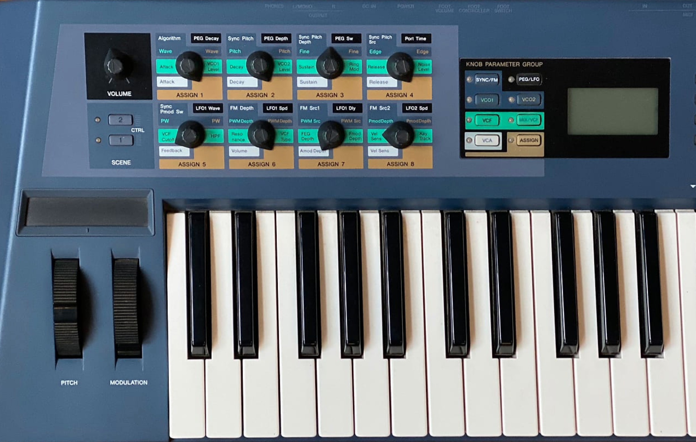

<br>
Firmware-based Yamaha AN1x emulator research, preparing a future **VST3/AU**
plugin. Repository name: **YamAN1x**.



*Original Yamaha AN1x hardware — illustrative photograph supplied by the project
owner. This is a photograph of the physical synthesizer, not a VST3/AU plugin
or a screenshot of YamAN1x.*

First public research snapshot: **2026-10-26** — [v0.1.0-research](https://github.com/RobCZart82/YamAN1x/releases/tag/v0.1.0-research). This is a development foundation. It does not yet produce AN1x audio,
complete a validated hardware-equivalent boot, or provide a plugin or GUI.

For Hungarian-language guidance and the relocated legacy notes, see: [Hungarian summary](README_HUN.md) · [relocated historical Hungarian passages](docs/HUNGARIAN_NOTES_HUN.md).

## Current verified main — PR #292 — 2026-11-14

PR [#292](https://github.com/RobCZart82/YamAN1x/pull/292) merged by squash at
`2026-11-14T14:52:58Z` from exact head
`7ae2fccee343257a67acb7541d30f191d2f925fe` to main
`6039cc3833c35a278517e4541ed3d84fb527bb2b`. PR-head Linux, macOS and Windows
checks passed in ROM-free CI run `43603781411`; initial-decode MSan passed in
`43603781407`. On exact main, Linux, macOS and Windows passed in ROM-free CI
run `43607171460`, and initial-decode MSan passed in `43607171485`. The main
Ubuntu job completed its extended UBSan/ASan checks successfully. MAME research
was path-filtered for this documentation-only change.

Codex's exact-head review completed without findings (summary comment
`6878585874`; receipt `6878605101`). GitHub review submissions, inline review
comments and review threads were zero. Ruleset `25910947` required zero
approvals and resolved review threads; no quota error was reported and no
merge bypass was used. PR #292 reconciles PR #291's merge evidence and the
current main baseline. It adds no runtime behavior or hardware, boot, MIDI,
DSP, audio or REAPER acceptance.

## Fresh local bounded firmware observation — 2026-11-14

A read-only AN1x 1.04 probe using the merged main build reached its requested
20,000,000-cycle limit with no CPU failure or access fault. It recorded
3,184,647 CPU callbacks, peripheral cycle `20,000,000`, PC `247044`, MEG
controls/status reads `5/1`, VOP3 writes `[11557,516]`, reads `[448,0]`, sample
passes `[0,0]`, GPIO writes `6329`, and zero ADC samples. Both
`audio_accepted` and `firmware_boot_accepted` remained false. This is only
bounded progress under the selected synthetic profile; it is not complete boot,
hardware agreement, MIDI, audio or REAPER acceptance. The ROM SHA-256 before
and after was `4f72c8c595258ec9de83006287cc9b14f1450349a2253ebbf4d7437c22f95cbe`;
it remains unchanged and outside Git. No new MAME build or run was made.

## PKS caller-input timing windows — local candidate — 2026-11-14

A bounded read-only observer now records the statically identified aligned
word `2349EA` in addition to the previously observed bases. Two fresh
nine-second passive/default-input probes on the pinned MAME source each
captured six `39AC` source-buffer writes. The `2349EA` read at post-fetch PC
`002A08` returned `4000/FF00` (`40` in the selected high byte) and preceded
the first three writes by 12,625, 20,125 and 27,625 ns; their byte values were
`E0 00 20`. The `237204` aligned-word read at post-fetch PC `001FD8` returned
`FF00/00FF` (selected low byte `00`) and preceded the next writes by 10,375,
17,875 and 25,375 ns; their values were `E0 00 00`. CCR snapshots are retained
as raw evidence without interpretation. Both run manifests matched on 26
non-trace fields. These timing windows do not establish causality, data meaning,
hardware agreement, complete boot, MIDI, DSP samples, audio or REAPER
acceptance. The ROM was unchanged and outside Git. The next candidate step is
to trace the upstream instruction/value path and independently recheck address,
value, lane, flags, timing and continuation.

## Verified runtime baseline — 2026-11-12

PR [#274](https://github.com/RobCZart82/YamAN1x/pull/274) merged on
2026-11-11 at 21:56:03 UTC (22:56:03 Europe/Budapest), from final head
`329a7bf626e251c39a3273eef69dad24ad3e161e` to main
`d9f9ffb04e5dee587efebf33b6cf6bfc17b95f94`. The final-head platform CI,
MSan and MAME research workflows passed (runs `43102583960`, `43102583923`,
`43102583907`). The exact-main runs also passed:
[Linux/macOS/Windows](https://github.com/RobCZart82/YamAN1x/actions/runs/43107390172),
[MSan](https://github.com/RobCZart82/YamAN1x/actions/runs/43107390248) and
[MAME research](https://github.com/RobCZart82/YamAN1x/actions/runs/43107390414).
[Codex review](https://github.com/RobCZart82/YamAN1x/pull/274#issuecomment-6806170735)
completed without findings on that final head; the earlier result-read finding
was addressed and its review thread is resolved.

The merged probe accepts an **opt-in constant AN3 input** and keeps ADDRD
word/high-byte/low-byte reads unmapped without it. During #274 development,
the read-only AN1x 1.04 diagnostic completed one 266-cycle conversion and
then stopped at a later unsupported ADC control write at `FFFFE8`. Runs at input
0 and 1023, each split at 4,096 and 1,000,000 cycles, reached the same boundary.
This is limited firmware progress only: full boot, physical ADC agreement,
MIDI, audio and REAPER acceptance remain open. The original MAME reference is
pinned at `706dbb73281320c54d7c2f16262c1c3786f2be01`; no new MAME build/run was
made for this probe-only increment. The ROM stayed unchanged and outside Git.

## Failed-write diagnostics — #276 merged — 2026-11-12

PR [#276](https://github.com/RobCZart82/YamAN1x/pull/276) added attempted
values to failed byte and word writes in the bounded probe, preserving its
fail-closed behavior. Four fresh read-only AN1x 1.04 runs (AN3 0/1023;
4,096/1,000,000-cycle slices) all report the `FFFFE8` byte-write value
`0x33`, post-fetch PC `1B84`, and peripheral cycle `95,707,121`; other
non-slice metrics match. The pinned MAME H8 ADC source classifies these
control bits as a software-started AN0–AN3 scan, but this is source
interpretation, not hardware validation. No unsupported mode is emulated.
Full boot, MIDI, audio and REAPER acceptance remain open.

## PR #277 merge verification — 2026-11-13

PR [#277](https://github.com/RobCZart82/YamAN1x/pull/277) merged on
2026-11-12T20:21:06Z from exact head
`6fa64ebcb2bfbb5cb72920c251117319d2819ed4` to main
`fce5f65ce5e43c36ceb7eb67a13f9f2040dbcb5a`. Its exact-head Linux, macOS,
Windows and MSan checks passed (workflow runs `43259845185` and
`43259845433`). MAME research was not run: this documentation-only change did
not match that workflow's `research/**`, `src/**`, tool or workflow path filters.
The exact-main Linux, macOS, Windows and MSan checks also passed (runs
`43299437756` and `43299436402`). The active ruleset requires all three platform
checks, zero approving reviews and resolved review threads. Codex's exact-head
review completed without findings (comment `6829550926`); GitHub recorded zero
review objects, inline comments and review threads. No quota error was reported
and no merge bypass was used. This PR only reconciles the #276 merge evidence
in the documentation and ledger; it adds no runtime behavior or acceptance.

## PR #279 merge verification — 2026-11-13

PR [#279](https://github.com/RobCZart82/YamAN1x/pull/279) merged at
2026-11-13T17:34:43Z from exact head
`bcdb21bada7c02912ebf8966fdadd99f08a25be5` to main
`40d7847ad23c05a1c11a52659dfbc4181dc0ebe2`. Linux, macOS, Windows, MSan and
MAME research checks passed on the PR head (jobs `132026604026`, `132026603408`,
`132026604067`, `132026603850`, `132026603857`) and on exact main
`40d7847` (jobs `132053535173`, `132053535251`, `132053534783`,
`132053535103`, `132053534152`). Codex's exact-head code review completed
without findings (issue comment `6859252684`); GitHub reviews and review threads
were zero. Active ruleset `25910947` requires zero approvals and resolved
threads; no quota error or bypass was involved.

The bounded probe now accepts the explicit eight-channel constant scan profile
and uses its AN3 entry for the preceding single conversion. Four read-only
100-million-cycle runs showed equal scan callback deadlines/counts across slice
sizes; AN3=0 versus 1023 changed the final CPU/GPIO trace, while VOP3 sample
passes remained zero. This is synthetic firmware progress only, not hardware,
boot, MIDI, audio or REAPER acceptance. ROM hash
`4f72c8c595258ec9de83006287cc9b14f1450349a2253ebbf4d7437c22f95cbe` is
unchanged and outside Git; the MAME source remains pinned at
`706dbb73281320c54d7c2f16262c1c3786f2be01` with no new build/run.

## PR #280 merge verification — 2026-11-13

PR [#280](https://github.com/RobCZart82/YamAN1x/pull/280) merged at
2026-11-13T19:02:41Z from exact head
`8eb0eaaac1b7390a43f323f09ba0adfee792e436` to main
`284c0f1a273b6212272b80458eba7b6417e4dfee`. Linux, macOS, Windows, MSan
and MAME research checks passed on the PR head (jobs `132081161291`,
`132081161363`, `132081160837`, `132081161511`, `132081161303`) and exact main
(jobs `132102887643`, `132102887232`, `132102887927`, `132102887298`,
`132102887771`). Codex's exact-head review completed without findings (issue
comment `6861430543`); GitHub review objects and threads were zero. Active
ruleset `25910947` required zero approvals and resolved threads; no quota error
or bypass was involved.

The bounded probe accepts an explicit constant input for all eight ADC channels
and has a 250,000,000-cycle / 50,000,000-callback finite ceiling. Four fresh
read-only runs reached that ceiling with no bus fault, `audio_accepted:false`
and VOP3 sample passes `[0,0]`. AN0–AN3 and AN4–AN7 scan start deadlines were
stable across slice sizes. The six-vector 100-million-cycle sweep found that
only AN3 changed the trace among the tested zero, maximum and one-hot values.
This is synthetic firmware progress only, not hardware agreement, complete
boot, MIDI, audio or REAPER acceptance. The ROM SHA remains unchanged and
outside Git; no new MAME build/run was made.

## Bounded firmware probe — merged in PR #286 — 2026-11-14

PR #286 raises the explicit boot probe's finite ceilings to 600,000,000
cycles and 125,000,000 callbacks; the slice ceiling remains 1,000,000. Four
fresh read-only AN1x 1.04 runs (AN3=0/1023 by 4,096/1,000,000-cycle slices)
all reached the cycle limit with no access fault. The first AN3 conversion was
at cycle `95,706,795`; AN0–AN3 scanning began at `95,707,121` with subsequent
first deadlines `[95707387,95707643,95707899]`, and AN4–AN7 began at
`127,793,965` with subsequent deadlines `[127794231,127794487,127794743]`.
These deadlines matched across all four runs. Final PC was `62010` for AN3=0
and `1896` for AN3=1023. Callback totals ranged from `94,217,090` to
`94,511,131` and varied by slice size. Each run reported VOP3 sample passes
`[0,0]`, `audio_accepted:false`, and `firmware_boot_accepted:false`. The probe
remains bounded and fail-stop. This does not establish physical control
agreement, complete boot, MIDI, audio or REAPER acceptance. ROM SHA-256
`4f72c8c595258ec9de83006287cc9b14f1450349a2253ebbf4d7437c22f95cbe` is
unchanged and outside Git; the pinned MAME source remains
`706dbb73281320c54d7c2f16262c1c3786f2be01`, with no new build/run.

## Build and test — no ROM required

Requirements: CMake 3.20+, a C++20 compiler, Python 3.9+, Git and platform build
tools. The reviewed VOP3 and AsmJit source snapshot is included, with original
licenses. Configuration does not download dependencies or Yamaha data.

```sh
cmake -S . -B build -DCMAKE_BUILD_TYPE=Release
cmake --build build --config Release --parallel 4
ctest --test-dir build -C Release --output-on-failure
python3 tools/repository_audit.py
```

The source-only build defines **138 CTest groups and 127 Python cases**. Tests generate synthetic
programs/banks in temporary directories. The two upstream tests that require
Yamaha images are not part of this suite. ROM-free GitHub Actions checks this suite on Linux x64, macOS Apple Silicon and
Windows x64; see the current status below for tested revisions.
This checks the source build, not AN1x hardware fidelity or plugin-host support.

See [engine architecture decision](docs/ADR-0001-engine-boundary.md) and
[build baseline](docs/BUILD_BASELINE.md) for the M0 decisions and remaining gates.

## PKS source-writer register cross-check — candidate — 2026-11-11

The bounded candidate checks the saved R1L low byte against the written source
byte lane at CPU-reported post-fetch PC `0039AC`. All six matching writes in
the locked nine-second passive MAME trace agree. This confirms only the
observed register-to-bus relation; it does not identify an instruction-start
PC, upstream calculation, PKS meaning, hardware behavior or audio. The trace
SHA-256 is `58d4c5008a95d85989eb8a66b8fbd3d400538564f9353bc6481aacd4439ac079`;
the MAME source remains pinned at
`706dbb73281320c54d7c2f16262c1c3786f2be01`. Focused tests pass 14/14 normally
and under Python `-O`; the full Python suite passes 127/127. The ROM remains
unchanged and outside the repository. This candidate is not hardware, boot,
MIDI or audio acceptance.

PR [#272](https://github.com/RobCZart82/YamAN1x/pull/272) reconciled the #271
merge record and ledger baseline. It was squash-merged from exact head
`69a38a8a9d255afb967e9be55589c4ac2e1310f2` as
`d37a305779b1c2ea53e014ac2eaefd3c67c9b63b` on 2026-11-11T17:53:47Z UTC.
All four required PR-head checks (`130651156472`, `130651155702`,
`130651156277`, `130651154922`) and all four exact-main checks
(`130703923814`, `130703924092`, `130703924103`, `130703924346`) passed.
MAME was path-filtered. GitHub had no reviews, threads or comments; no
automated-review result or quota error was recorded. Ruleset `25910947`
required zero approvals and resolved threads; no bypass was used. The original
ROM remained unchanged and outside the repository.

## PKS source-byte CPU context — merged in #267 — 2026-11-10

PR [#267](https://github.com/RobCZart82/YamAN1x/pull/267) merged by squash as
`dae0d64db4d463d119ee7be1c452c90a8487513d` from verified PR head
`411524cd9797db6e0aa7b9f3d0b14340eb50b52c`, based on
`b04ff5e8ed1d8537c51b8a9ad0d03cf11494d36a`. The bounded, read-only MAME
observer, independent parser/auditor, tests and evidence are now on main.

Two nine-second passive/default-input runs produced identical 43-event source
context traces (SHA-256
`012b91ce66f3b3fdef937ef374f405d6004a53fc7703059d1e75c3bcecbe2d76`) with
no drops. The prior 1,928-line PKS context trace also matched. Six observed
source-read/payload-write pairs matched byte value, destination, R0L/ER4 and
250 ns of MAME virtual time. CCR is recorded without assigning flag meaning.
The local AN1x 1.04 ROM SHA-256 remains
`4f72c8c595258ec9de83006287cc9b14f1450349a2253ebbf4d7437c22f95cbe`;
it was not modified or added to the repository.

All five checks passed on the exact PR head: Linux, macOS, Windows, initial-decode
MSan and MAME research (check-run IDs `129967758579`, `129967758860`,
`129967758798`, `129967758081`, `129967758518`). Codex review completed
without findings on that exact head (comment `6772060805`). GitHub recorded
zero review objects and zero review threads; no quota issue was reported. The
active ruleset requires zero approvals and resolved threads. All five checks
also passed on the merge commit (IDs `129989103239`, `129989103935`,
`129989103739`, `129989105616`, `129989104714`). Squash merge used the
verified head without bypass.

This evidence is limited to one passive profile and does not establish PKS or
ADC semantics, hardware agreement, complete boot, MIDI acceptance or audio.
Next: trace the preceding writes and instruction context around the bounded
source/payload observations, retaining independent address/value/flag/time and
continuation checks. Do not infer a protocol or add HLE replies from observation
alone. Full reset, firmware/MIDI, DSP fidelity, audio, VST3/AU and REAPER
acceptance remain open. M0 is partial; M1 is prepared but unaccepted.

## Audit corrections and next work — 2026-11-10

Recorded preparation baseline: [#265](https://github.com/RobCZart82/YamAN1x/pull/265),
`5421585951258f430ea13fd40207bdabd23ed654` (documentation reconciliation),
following the #264 read-only PKS-context research code. That baseline had
137 CTest groups/109 Python cases. This source tree adds four Python regressions:
**137 CTest groups/113 Python cases**. Exact merge/remote-check status of this
correction is tracked on [PR #266](https://github.com/RobCZart82/YamAN1x/pull/266); no self-referential merge SHA is predicted.

The corrections reject stale standalone ADC scan restarts without mutation,
validate complete successful PKS probe manifests before comparison, and reconcile
the development records and twelve-patch source inventory. ADC guard tests also
run in the Linux ASan/UBSan group. Release build and 136/136 locally runnable CTest groups pass (51.54s). Python:
112/113 pass; one established Windows symlink privilege case is blocked. All ten
PKS audit tests also pass under Python -O. Source/notice/link/ledger checks pass.
Local sanitizers were not run; this change adds the ADC target to Linux sanitizer CI.
Own remote checks and merge status are recorded on the correction PR.
No firmware/hardware/MIDI/audio acceptance is added by these synthetic checks.

Active internal-clock ITU scheduler/MMIO/CPU IRQ delivery was completed in
#215–222; bounded ADC conversion/scan/restart integration followed in #229–242.
These are supported source profiles, not complete peripheral/hardware coverage.
Next research step: follow the preceding writes/instruction context of the PKS
operand RAM snapshots from #264, with independent address/value/flag/time checks.
Do not infer the PKS protocol or introduce HLE replies from observations alone.
Full reset, firmware boot/MIDI, DSP clock/table/EG fidelity, audio, VST3/AU and
REAPER acceptance remain open. M0 is partial; M1 is prepared but unaccepted.
Older dated candidate/pending entries preserve their preparation-time observations;
they do not override this summary.

## Firmware diagnostic evidence — 2026-11-09

## PKS operand CPU context — merged in #264

A bounded, read-only MAME observer now captures the post-fetch PC, virtual time, CCR and ER0–ER7 when firmware reads/writes the three previously observed aligned RAM word bases `237202`, `237204` and `2349E8`. The observer has a 4,096-event cap, reports overflow, filters all other addresses and does not change bus values. It was built against the pinned MAME source `706dbb73281320c54d7c2f16262c1c3786f2be01`; instrumented binary SHA-256 `0a7115cb99760c3644affe2a8f22a4491a180a824ab21b1d2b18d700174c1768`. The matching uninstrumented build hash is `6269f609a41a7e9e7202d2be9d3edc03f8744b48219fac0c9ebdfe1fea0746ff`.

Two nine-second passive/default-input runs produced byte-identical context traces (1,928 events; SHA-256 `8acf5f8c23ce9a912be8fa0a25323be342ab3f37084d3fbed012a18b5133172e` each). Per run, `2349E8` had 480 reads/483 writes, `237202` had 478 reads/4 writes, and `237204` had 478 reads/5 writes. All events fit within the cap without drops. The baseline and instrumented `run.json` matched on all 26 non-trace fields; only command path, binary hash and trace-line count were excluded. ROM identity remained AN1x 1.04 SHA-256 `4f72c8c595258ec9de83006287cc9b14f1450349a2253ebbf4d7437c22f95cbe`; no ROM contents were changed or added to the repository.

This is limited repeatability evidence for one nine-second passive profile. The callback PC remains the CPU-reported post-fetch PC, not an instruction-start PC. The run does not establish operand meaning, ADC arithmetic, PKS behavior, complete boot, MIDI acceptance, hardware agreement or sound. VOP3 samples remained zero. Next: use these bounded snapshots to follow the preceding value writes and their instruction context, retaining independent value/address/flag/timing and continuation checks.

PR [#264](https://github.com/RobCZart82/yaman1x/pull/264) merged by squash at `a2f52d020ebc6d70e7ade57d9b78a920a9e2af4c` on 2026-11-09T17:35:18Z from verified head `1092df38cb5278e3db50ef29ac6c99fa621c85ce`. PR-head checks passed (ROM-free CI `42652447163`, MSan `42652447223`, MAME research `42652447044`); merge-commit checks passed (ROM-free CI `42666087454`, MSan `42666087385`, MAME research `42666087403`). Codex's review summary completed without findings on the exact head; no GitHub review objects or threads were present, and no quota issue was reported. The active ruleset required zero approvals and resolved review threads. Two macOS hosted-runner acquisition attempts failed with explicit hosted-capacity annotations; after each workflow completed, only the failed job was retried, and the third attempt passed. Squash merge used the verified head without bypass.

The prior bounded RAM observations were merged in [#262](https://github.com/RobCZart82/yaman1x/pull/262). This merged context trace extends that work without asserting data semantics. See [current status](docs/STATUS.md) and [bounded observations](docs/pks-payload-path.md).

## Verified research baseline — 2026-11-09

Verified research-code baseline: `a2f52d020ebc6d70e7ade57d9b78a920a9e2af4c` (#264); #265 reconciled its records. #264 records the bounded PKS operand CPU-context observer and its limited passive-profile evidence. PR-head ROM-free CI `42652447163`, MSan `42652447223` and MAME research `42652447044` passed; merge-commit checks `42666087454`, `42666087385` and `42666087403` passed. Codex’s review summary completed without findings on the exact PR head; no GitHub review objects or threads were present and no quota issue was reported. The ruleset requires zero approvals and resolved review threads. Squash merge used the checked head without bypass.

The suite defines **137 CTest groups and 109 Python cases**.

Historical research-sink reset fix: [#213](https://github.com/RobCZart82/yaman1x/pull/213),
`d60e6eb9907d0a9c89938e1677d68e54b319da74`, merged 2026-11-05T09:09:33Z (10:09:33 Europe/Budapest).
Tested PR head: `a421a261a6647e759dac7d5132567d82f2de32fc`.

The #213 suite defined **131 CTest groups and 103 Python cases**.
[Linux/macOS/Windows and Linux sanitizers PASS](https://github.com/RobCZart82/yaman1x/actions/runs/41996686134),
[MSan PASS](https://github.com/RobCZart82/yaman1x/actions/runs/41996686447),
[MAME research PASS](https://github.com/RobCZart82/yaman1x/actions/runs/41996686368).
These results belong to #213's final PR head. Automated review completed without
findings on source commit `95b7edb0feaa97be23d1105fe59b6f259596e640`; only PR-link
documentation changed afterwards (three files). No final-head review is claimed. The actual macOS runner is15; the required check retains its old name.

Bounded shared SYSCR modes, absolute machine time, supported subset reset,
LCD/MEG/native register-only VOP3 research adapters, and standalone ITU counter,
flags, deadlines and exact-time vector dispatch are implemented. The full
hardware RESET line and boot remain unaccepted. ITU scheduler/MMIO/CPU IRQ
integration and subsequent firmware diagnostics were completed later in #215–222;
the FFFF60 boundary describes the historical #213 stage.
PKS/MIDI, DSP clock/table/EG fidelity, audio rendering, VST3/AU and REAPER
acceptance remain open. M0 is partial; M1 is prepared but unaccepted.

Merged fix: complete external research-sink cold reset through LCD
or MEG base references, with safe base ownership/destruction. Local regression
reproduced retained MEG/VOP3 state before the fix and passes after it. Own
Release build and 130/130 locally runnable CTest groups PASS (53.85s). Python:
102/103 PASS, one symlink case blocked by Windows privilege (WinError1314).
Source/notice audits and document links PASS. Local sanitizers not run; own
remote platform/UBSan/ASan/UBSan, MSan and MAME checks passed. No active engine
candidate is recorded. This documentation reconciliation changes no runtime code.
Machine subset reset still retains external chips; explicit sink cold reset
must be called with the machine stopped. No Yamaha data is needed.

Merged #158 reconciles the audit documentation. #159–164 pin reset input,child
configuration,queued RESET and scheduler time contracts from the fixed MAME
reference. #165 adds a tested standalone absolute/reset-relative time policy.
Merged #166 connects the absolute clock to research-machine execution and cold
reconstruction,with split-run/input/wire tests and ten ASan/UBSan CI groups.
Merged #167 adds a CPU-only deferred reset request between run calls:
completed bus-cycle debt is retained and repaid before reset vector fetches.
This project-owned policy is not a physical RESET line or machine reset API.

CPU/bus cold reconstruction and component reset tests exist;whole-machine warm
reset and complete firmware boot are **not accepted**. The machine clock stays
monotonic within each cold epoch;CPU debt and queued input remain owned by their
existing components. Hardware reset ordering and assertion/release integration
remain open. Firmware MIDI/PKS acceptance,DSP/table/EG/audio routing,offline
reference sound,realtime rendering,VST3 and REAPER acceptance remain open.
No AN1x audio,VST3,AU or GUI is currently delivered. No project-wide release
license has been selected. ROMs remain local and unchanged.

Merged #168 resets supported bus peripherals without rewinding absolute time or
pending RX. #169 coordinates CPU/bus subset reset at debt-free stopped boundaries,
with separate reset count/relative time and fail-stop reentry handling.
Merged #170 adds boot diagnostics;#171–173 add constrained ABWCR,ASTCR and
programmed WCR/WCER profiles with checked2..6-cycle access costs. Physical
reset/WAIT/pin-mode limitations remain documented. Merged #186 introduced disabled ITU interrupt enables and empty status flags
on five stopped channels;active timer events/IRQs remain unsupported.
The separate source-stub candidate profile reaches VOP3 word write440002 at
cycle10832302. Existing observational/default profiles remain strict on MEG reads.
No physical MEG readiness,complete boot,audio or effects acceptance follows.
Next inspect VOP3 host integration;MEG status needs independent specification/capture.
See [source-stub experiment](docs/meg-source-status-experiment.md).
One PR at a time;candidate validation and CI/review are separate gates.

See the [development plan through the first sound in REAPER (Hungarian)](docs/FIRST_REAPER_SOUND_PLAN.md)
for the planned firmware, audio-engine and VST3 milestones and acceptance criteria.

- Read-only AN1x 1.04 ROM identification, byte view and reset-vector inspection.
- AN1x bulk-SysEx structure/checksum validation and synthetic upload adapter.
- Two VOP3 instances, C ABI 2, register replay and independent upload-state audit.
- LCD bus model and a separate instrumented MAME research patch chain.
- Two standalone H83002 SCI channels with byte/word MMIO and DMA-qualified
  interrupt routing to the H8H controller; synthetic CPU/scheduler RX/TX and
  receive-error integration is tested, while full AN1x machine integration remains open. See [SCI MMIO/IRQ evidence](docs/h83002-sci-mmio-irq.md).
- Opt-in experimental upload-control and selected EG-level readback profiles.
- Integer sample clock; synthetic tests run 2400 samples per chip with matching
  results under different call partitions.
- Standalone H8 GPIO, internal/external IRQ helpers and a shared asynchronous
  SCI TX/RX channel, with synthetic timing, status and isolation checks. The
  bounded CPU/SCI/GPIO/IRQ integration is implemented; complete machine
  coverage, reset and firmware acceptance remain open.

The local firmware research run loads both complete DSP programs under the
experimental status profile. Its audited upload fields match Python
reconstruction and native replay. The H8 harness is register-only by default;
an explicit `assumed-48k` profile advances both DSP models before MMIO. The
complete eleven-patch research target also builds in separate macOS CI without
Yamaha data. A known upstream EG target-hold discrepancy, the
AN1x clock and table-ROM scaling remain unresolved. These are recorded in
[development status](docs/STATUS.md) and the [roadmap](docs/ROADMAP.md).

The [development ledger](docs/DEVELOPMENT_LOG.md) records merged changes and
maintenance rules. The [dated repository audit](docs/REPOSITORY_AUDIT_2026-10-28.md)
preserves the October28 snapshot;the current status and ledger supersede it. Contribution requirements
are in [CONTRIBUTING.md](CONTRIBUTING.md).

## Local firmware research

No Yamaha firmware, program/table-ROM image, bank, service manual, raw capture,
compiled emulator or plugin is included. Keep local inputs and captures outside
the checkout or in ignored `roms/` and `private_runs/` folders. These inputs stay local and are not published with this repository.

```sh
python3 tools/rom_inspect.py /path/to/local-firmware.zip
python3 tools/bank_inspect.py /path/to/local-bank.syx
python3 tools/an1x_table_rom_audit.py /path/to/local-firmware.bin /path/to/VOP3-main.zip \
  --table-rom-member VOP3-main/docs/vop3_an1x/maskrom.bin
```

These tools do not change their input files. The table-ROM audit compares known
table regions with the CPU-ROM copy; it does not verify DSP address scaling or
hardware fidelity. The separate macOS MAME research build needs a compatible
local MAME source snapshot and separately obtained local firmware. See
[research instructions](research/README.md). It is not linked into this core,
and is not part of the default build.

## Source provenance and licensing

See [THIRD_PARTY.md](THIRD_PARTY.md), [licensing status](LICENSE) and the
per-file snapshot hashes in `third_party/provenance.json`. No project-wide
open-source license for the project's own code has been selected yet.
Upstream source files retain their licenses and copyright notices.

`tools/repository_audit.py` checks candidate Git files, disallowed file types,
binary/secret/path markers and every vendored source hash. The original hardware
photo and project logo are permitted only at their exact approved paths/hashes;
see [asset provenance](docs/images/README.md). It is an upload
check, not a guarantee of firmware authenticity or hardware fidelity.

Product spelling is **YamAN1x**. Existing internal `yamanix` identifiers and the
`YAMANIX` trace protocol are retained for reproducibility. Older local reports
use the previous working name YamANIx; historical context is explained in
[research history](docs/HISTORY.md).

The default branch uses an [active PR-based protection ruleset](docs/BRANCH_PROTECTION.md).

## Historical component increments

The following notes describe each increment at its original scope. Their old
coverage and pending-task statements are historical; current integration, counts
and remaining work are recorded above.

The bounded [integer-cycle dispatcher](docs/cycle-dispatcher.md) is a tested scheduling primitive; CPU/peripheral integration remains pending.

The [two-channel SCI timeline](docs/sci-cycle-timeline.md) now combines timestamped RX input with bounded UART clock dispatch. Its tie order is a software convention; CPU integration remains open.

The [H8 host-services boundary](docs/h8-host-services-boundary.md) records source-derived bus/cycle requirements and the remaining work before embedded CPU compilation.

The [H8H bus-access helpers](docs/h8h-bus-access.md) preserve source-defined word alignment, instruction/data routing and pre-access cycle charging. Full CPU execution remains open; a first generated subset is described below.

The [H8 execution budget](docs/h8-execution-budget.md) preserves inter-slice cycle debt and peripheral-boundary arithmetic; the first generated handler subset is now connected, while complete instruction coverage remains open.

The [first generated H8 instruction profile](docs/h8-first-instructions.md) compiles and executes reset, NOP, MOV.B immediate and BRA rel8 with per-instance register/prefetch/substate storage. Original H8H decoder/handler comparison agrees across 200,000 synthetic slices. Other opcodes fail explicitly; this is not a complete CPU, firmware boot or audio result.

The [H8H memory/branch extension](docs/h8-memory-branches.md) adds MOV.L immediate32, indirect byte data reads/writes and all 16 short branch conditions. The isolated original-decoder comparison agrees over 200,000 mixed slices; full CPU, IRQ/SCI integration and firmware acceptance remain open.

The [word/long memory extension](docs/h8-word-long-memory.md) adds aligned word data callbacks and original two-stage prefix decoding for long transfers. Mid-transfer continuations, aliases and wrap cases are tested against the original H8H execution path; complete CPU/firmware acceptance remains open.

The [H8H arithmetic extension](docs/h8-arithmetic-flags.md) adds selected ADD/SUB/CMP forms at 8/16/32 bits, verified against independent mathematical flags and the original H8H path. Full CPU, IRQ/SCI and firmware/audio acceptance remain open.

The [carry/register/logic extension](docs/h8-carry-register-logic.md) adds byte carry-input/sticky-Z arithmetic, wide register arithmetic, logical forms and CCR storage. Multi-byte arithmetic is tested against independent full-width results; IRQ entry and full firmware/audio acceptance remain open.

Selected CPU extension: [H8 word/long register logic](docs/h8-wide-register-logic.md).

Selected CPU extension: [H8 single-bit shifts and rotates](docs/h8-shift-rotate.md).

Selected CPU extension: [H8 register bit operations](docs/h8-register-bit-operations.md).

Selected CPU extension: [H8 indirect memory bit operations](docs/h8-memory-bit-operations.md).

Selected CPU extension: [H8 absolute memory bit operations](docs/h8-absolute-bit-operations.md).

Selected CPU extension: [H8 stack and control flow](docs/h8-stack-control-flow.md).

Merged extension (historical candidate): [coverage and CCR family](docs/h8-coverage-and-ccr.md).

Merged extension [register-to-register transfers](docs/h8-register-transfers.md) extend MOV at all three widths with lane/alias/flag checks.

Merged extension [small arithmetic](docs/h8-small-arithmetic.md) adds INC/DEC and ADDS/SUBS with explicit flag-preservation checks.

Merged extension [unary/extension family](docs/h8-unary-extension.md) adds NOT/NEG/EXTU/EXTS with independent value/flag expectations.

Merged extension [fixed-profile TRAPA entry](docs/h8-trapa-entry.md) adds synchronous trap stack/vector handling; external IRQ/NMI remains separate.

Historical extension: [signed16 displacement memory moves](docs/h8-displacement16-memory.md).
